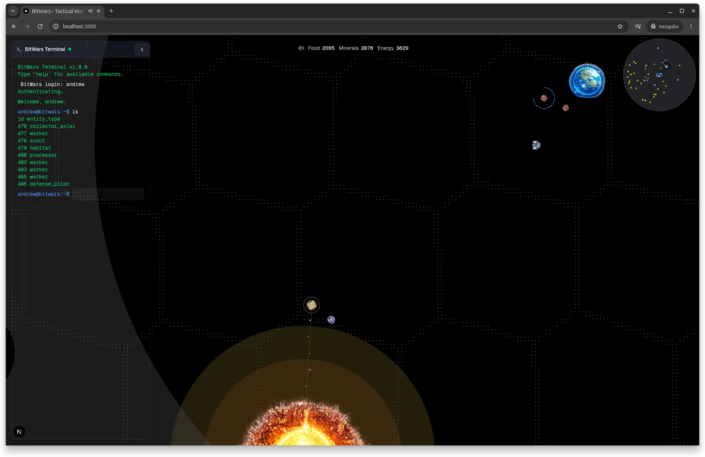

A Multi-Player RTS game built with Next.js, Redis, TypeScript, and Rust.



## Getting Started

First, install dependencies, start Redis Stack, start the dev servers, and (optionally) seed some mock data:

 From the repository's root:
```bash
pnpm run clean
pnpm install
docker compose up -d
pnpm dev

# In another terminal (optional data init for the web app):
pnpm -C apps/web run db:init
```

Open [http://localhost:8001/redis-stack/browser](http://localhost:8001/redis-stack/browser) with your browser to connect to Redis Stack.

## Other Scripts
- `pnpm game:reset` -- clear game state and player db
- `pnpm -C apps/web storybook` -- start storybook

## Working Endpoints

- `POST /api/init` - Initialize any required indexes/state (development convenience)
- `POST /api/players/mocks/create_players` - Seed mock players (development/testing)

## Monorepo Structure
```
bitwars/
├─ docker-compose.yml     (redis-stack cache and ui)
├─ docs/                  (documentation)
│  ├─ requirements/       (High-level future requirements)
│  ├─ milestones/         (Detailed development milestones that latter up toward requirements)
│  ├─ adr/                (Architecture Decision Records)
│  ├─ glossary.md         (Shared terminology)
│  ├─ milestones.md       (High-level overview of milestones)
│  └─ README.md           (Documentation index)
├─ apps/
│  └─ web/                (Next.js 15 app; dev scripts and API routes under `/api`)
├─ crates/                (currently empty)
├─ packages/
│  ├─ content/            (Entity type definitions; build generates TS list for the front-end)
│  ├─ schemas/            (Protobuf schema definitions)
│  └─ shared/             (TypeScript types generated from protobuf schemas)
└─ services/
   └─ rts-engine/         (Rust server/engine; Redis client, examples, protobuf build)
```

### Content pack (`packages/content`) and entity types on the front-end

The **content pack** is the source of truth for entity/resource/technology definitions and entity artwork. The engine and web server must share `packages/content` and its immutable `.revisions` storage.

- **Edit live content** at `/content/entities`, `/content/techtree`, and the sprite editors. Authenticated saves stage a revision automatically; the engine validates and applies it between ticks, including while paused. Existing clients update without reconnecting.
- **External file edits** are published with **Publish files** in the content navigation's **Live content** panel, or authenticated `POST /api/content/reload`. There is no filesystem watcher.
- **Versioning** uses a global SHA256 content revision, per-entity definition hashes, and independent sprite-bundle hashes. Immutable assets are served at `/assets/<entity_id>/<asset_hash>/<filename>`. Gameplay definition changes do not invalidate unchanged textures.
- **Safety and diagnostics:** invalid/incompatible revisions leave the active game unchanged. The Live content panel shows reload IDs, transition history, errors, activation ticks, client synchronization, and retained client failure/recovery history.
- **Restart safety:** snapshots record their active revision; restoration loads that retained revision rather than current authored files. Back up `.revisions` alongside Redis snapshots. A legacy snapshot without a revision adopts current disk content once with a warning.
- **Build-time content generation** still supplies editor metadata and standalone rendering labs. The live game loads its accepted definitions and artwork from the server, so new entity types do not require rebuilding the web app.

See [content revision requirements](docs/requirements/entities-and-abilities.md#data-model-and-content-pipeline) and [reload inspection endpoints](docs/game-query.md#content-reload-diagnostics).

### Using pnpm in monorepo
Adding dependencies at the root level is easy, you simply run your pnpm commands at root.

Adding dependencies to a specific package is a bit more involved. You need to run pnpm install --filter <package-name>, e.g.,
```bash
pnpm -F bitwars add @bufbuild/protobuf
```

## Environment Variables

Configuration is loaded from the root `.env` file. The `dev` and `fe:run` scripts use `dotenv-cli` to inject these into the process.

| Variable | Default | Description |
|---|---|---|
| `GAME_ID` | `demo-001` | Unique identifier for the game/match |
| `PORT` | `3001` in `.env.example` | Next.js dev/start port. `pnpm dev` binds it directly instead of falling back when 3000 is busy; keep `BITWARS_GAME_QUERY_BASE_URL` aligned. |
| `GAME_TPS` | `20` | Authoritative simulation ticks per second. Weapon cooldowns in the bundled content are tuned for 20 TPS. |
| `GAMESTATE_REDIS_URL` | `redis://127.0.0.1/` | Redis connection URL |
| `RTS_ENGINE_LOG_LEVEL` | `INFO` | Tracing log level for the Rust engine |
| `RESTORE_GAMESTATE_ON_RESTART` | `false` | When `true`, the engine restores world state from the latest Redis snapshot on startup and replays only post-snapshot intents. When `false` (default), all game Redis streams are flushed and a fresh world is generated — no replay of old intents. Set to `true` for crash recovery; leave `false` during development. |
| `MAX_CMDS_PER_TICK` | `192` at 20 TPS | Maximum intents ingested per engine tick (backpressure); default scales with `GAME_TPS` to retain 3,840 intents/second of theoretical capacity. |
| `MAX_BATCH_MS` | `15` at 20 TPS | Maximum ms spent processing intents per tick (0 = unlimited); default scales with `GAME_TPS` to retain 300 ms/second of processing allowance. |
| `RAIDER_AI_SPATIAL_INDEX_MODE` | `on` | `on`, `off`, or `alternate`. `alternate` uses deterministic 10-second on/off blocks and emits separate Axiom timing summaries for each mode. |
| `RAIDER_AI_SPATIAL_INDEX_ENABLED` | `true` | Legacy on/off toggle; use `RAIDER_AI_SPATIAL_INDEX_MODE` for new experiments. |
| `AXIOM_TOKEN` | *(none)* | Axiom API token for telemetry (optional) |
| `AXIOM_DATASET` | *(none)* | Axiom dataset name for telemetry (optional) |
| `AXIOM_ORG_ID` | *(none)* | Required when `AXIOM_TOKEN` is a personal access token |
| `NEXT_PUBLIC_DEBUG_MOVE_INPUT` | `0` | Web-only debug flag. Set to `1` to enable move-input observability (console logs + small on-screen badge in `GameStage`). |

The bundled entity cooldowns are calibrated for 20 TPS. Start a fresh match when changing
`GAME_TPS`: a restored active delivery can contain a future `retry_tick` written at the
previous rate, so its remaining wait would change after a rate switch.

### Move Click Detection (Web)

Move-command click detection in the web client is handled at the Pixi stage level (not via a bounded world "ground" hit area). This avoids losing move clicks when the camera/entity is far from world origin.

- Source: `apps/web/src/features/pixijs/components/GameStage.tsx`
- Approach:
  - `app.stage` is configured for pointer hit testing over the canvas.
  - Stage `pointerdown` handles deselect (non-Move mode) and move intent dispatch (Move mode).
  - Entity clicks in Move mode are allowed to bubble so clicking an entity can still issue a move command.
  - Minimap clicks are explicitly ignored by move input handling.
- Observability:
  - Set `NEXT_PUBLIC_DEBUG_MOVE_INPUT=1` to emit `console.debug` traces and render a tiny top-right "move-input" debug badge showing the latest decision (`ignored:*` or `dispatched`).

### World-view scale

Below the minimap, a centered scale bar spans 90% of the minimap width.
Its left tick is fixed; the right tick moves between approximately half and full
width as the camera zoom changes. The centered label below gives the world-view
distance between ticks in units, stepping through powers of two. This measures
the main view, not the minimap's nonlinear distance projection.

## rts-engine
This is the Rust server that will run the game loop. It integrates with Redis and protobuf-generated types.

Common tasks from repo root (see `package.json`):
```bash
# Build and run
pnpm engine:build
pnpm engine:run

# Utilities/examples
pnpm engine:generate-examples
pnpm engine:read-snapshot
pnpm engine:read-deltas
```

You can also invoke Cargo directly:
```bash
cargo build -p rts-engine
cargo run -p rts-engine
```

### Replay tests (`pnpm test:replay:x`)

Named replay tests run a scenario (beginning world state, entities, predefined intents, predefined ticks) against the in-memory sim engine and assert the final world hash (xxh3). No Redis required.

**Run a replay test** (from repo root):

```bash
pnpm test:replay:two_entities_move
```

Exit 0 means the hash matched; exit 1 means mismatch (a minimal diff is printed).

**Add another scenario:**

1. Define the scenario in `services/rts-engine/src/bin/replay_test.rs` inside `scenarios()`: set `initial_state`, `intents`, `total_ticks`, and use `expected_hash: 0` and `expected_json: ""` as placeholders.
2. Run with `--golden` to print the expected hash and JSON:
   ```bash
   cargo run -p rts-engine --bin replay_test -- <scenario_name> --golden
   ```
3. Paste the printed `expected_hash` and `expected_json` into the scenario in `replay_test.rs`.
4. Add a script in the root `package.json`:
   ```json
   "test:replay:<name>": "cargo run -p rts-engine --bin replay_test -- <name>"
   ```

### Latency probe

The latency probe sends 100 Move intents to the engine and reports p50/p95 latency from submit to first RECEIVED/ACCEPTED lifecycle event. Requires the engine running with the same `game_id`. Metrics are written to `./.metrics/m0.1/`. See [docs/tools/latency-probe.md](docs/tools/latency-probe.md) for full usage.

```bash
pnpm run latency:probe -- <game_id>
# Example (engine must be running with GAME_ID=testgameid):
pnpm run latency:probe -- testgameid
```

### Schema check

The schema check regenerates TS and Rust from `.proto` and fails if generated files are out of sync. Run it before committing after proto changes; it also runs in CI. See [docs/tools/schema-check.md](docs/tools/schema-check.md) for details.

```bash
# Run locally (from repo root)
pnpm schema:check

# If it fails: regenerate and commit
pnpm --filter @bitwars/schemas run gen:ts
cargo build -p rts-engine
# then git add and commit packages/shared/src/gen services/rts-engine/src/pb
```

## Side-by-side testing of type decoding
In nextjs:
```bash
pnpm --filter bitwars run test:read-redis
```

In rust:
```bash
pnpm engine:read-deltas
```

## Documentation

See `docs/` for specifications and design:
- `docs/README.md` – documentation index
- `docs/requirements/` – system requirements
- `docs/adr/` – Architecture Decision Records (e.g., `001-scripting-engine-and-sandbox.md`)
- `docs/milestones.md` – development roadmap
- `docs/glossary.md` – shared terminology
