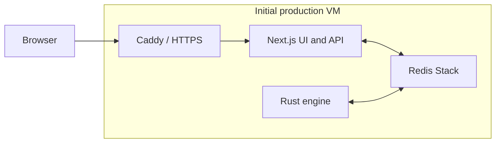

# Production hosting options

Last updated: 2026-10-23

This document compares initial hosting options for Bitwars. It is planning guidance, not a deployment specification or a capacity guarantee. No provider has been selected.

Prices below are approximate monthly planning estimates, not verified current quotes. Check provider calculators before purchasing. Estimates assume continuously running services, modest traffic, and small initial workloads; exclude taxes, credits, and substantial bandwidth unless stated otherwise.

## Recommendation

Start with one VM running the Rust engine, Redis Stack, and Next.js, with Caddy or another reverse proxy providing HTTPS. Use Docker Compose or systemd to supervise the services. A machine with about 2 vCPUs and 4 GB RAM is a reasonable starting candidate, subject to load testing.

This keeps cost and deployment complexity low, but a host failure takes down the whole application. Backups provide recovery, not high availability.

- For AWS familiarity and ecosystem integration, start with EC2 or Lightsail.
- For low infrastructure cost and included bandwidth, compare Hetzner Cloud.
- For straightforward VM operations and billing, compare DigitalOcean or Akamai Cloud/Linode.
- For managed application deployments, compare Railway or Render, accounting for Redis Stack compatibility and persistence.

Build the Rust release binary and production Next.js application in CI rather than on a small production VM. Keep the deployment portable through containers and environment-based configuration.

## Current architecture and constraints



The services have different requirements:

| Service | Hosting implications |
|---|---|
| Rust engine | Continuously running authoritative simulation; predictable CPU time matters. The default 20 ticks/second leaves 50 ms per tick. |
| Redis Stack | Stores player documents, game snapshots, and streams. Treat it as a datastore, not a disposable cache. Requires persistent storage and recovery planning. |
| Next.js | Serves the UI, APIs, and persistent server-sent event (SSE) connections. An always-running Node server is a straightforward fit. |

The application uses RedisJSON and Search commands, including `JSON.SET`, `FT.CREATE`, and `FT.SEARCH`. A service advertised as Redis-compatible is not automatically a compatible replacement. Verify required commands, engine/version support, persistence, connection limits, and streaming behavior before selecting managed Redis or Valkey.

Keep the engine, Redis, and web server close together initially. Deploying web servers in multiple regions provides limited benefit while every game command must reach one authoritative engine.

## AWS options

The following estimates assume US East, Linux on demand, and 730 hours/month. Managed datastore size and compatibility can materially change the totals.

| Setup | Approximate monthly baseline | Appropriate use |
|---|---:|---|
| Lightsail, all services on one 4 GB VM | $24–35 | Simple prototype with bundled storage and transfer |
| EC2, all services on one 4 GB VM | $32–45 | Initial deployment using standard AWS infrastructure |
| Two small EC2 instances, Redis alongside the engine | $45–80 | Separate web deployments and resource usage |
| ECS Fargate for web and engine, plus a compatible managed datastore | $80–180+ | Reduce host maintenance at a higher baseline cost |
| EKS and supporting infrastructure | $150–300+ | Existing Kubernetes operations or broader infrastructure needs |

### EC2 starting budget

A `t4g.medium` provides 2 vCPUs and 4 GB RAM. Confirm ARM support for the application dependencies and Redis image before choosing Graviton; an equivalent x86 instance costs somewhat more.

| Item | Illustrative monthly cost |
|---|---:|
| Instance at approximately $0.0336/hour | $24.53 |
| 30 GB gp3 EBS | $2.40 |
| One public IPv4 address | $3.65 |
| Modest snapshots, logs, and DNS | $2–10 |
| Total before significant outbound transfer | $33–41 |

Budget roughly $35–50/month for an initial EC2 deployment. This is a configuration estimate, not a prediction of supported player count.

An initial single-host setup can serve HTTPS directly without an Application Load Balancer or NAT Gateway. Those services can each add tens of dollars per month before significant traffic. Add them when the deployment needs their functionality rather than as default infrastructure.

T-family instances are burstable. Sustained CPU consumption can exhaust credits or incur surplus-credit charges, depending on configuration. If the simulation regularly consumes substantial CPU, compare fixed-performance instances using measured tick latency.

### ECS and Fargate

ECS on EC2 has no separate ECS control-plane charge and provides container management while retaining instance-based compute costs. It is a useful next step if deployment coordination becomes cumbersome.

Fargate removes host maintenance, but continuously running tasks generally cost more than consolidating small services on one VM. Budget for networking, load balancing, logs, and a compatible managed datastore as well as task CPU and memory. Avoid treating a Fargate task's ephemeral filesystem as durable Redis storage.

### Kubernetes / EKS

EKS standard-support control-plane pricing is approximately $0.10/hour, or $73/month, before worker compute, storage, load balancing, and networking. Extended support and additional features can cost more.

Kubernetes does not make multiple replicas of the authoritative engine safe automatically. A world still needs explicit ownership, failover, and potentially sharding. Avoid deploying overlapping engine replicas for the same world during updates unless the application supports that coordination.

For three services at this stage, EKS adds cost and operational work without resolving the primary simulation-scaling constraint. Reconsider it when managing many worlds or services, or when an existing Kubernetes platform makes it economical.

## Other hosting providers

These ranges cover small starting configurations and are not equivalent capacity or availability guarantees. Managed platforms may require a larger bill once actual memory, persistent storage, and egress usage are known.

| Provider | Approximate monthly starting cost | Strengths | Main considerations |
|---|---:|---|---|
| Hetzner Cloud | $8–25 | Low compute cost; generous included transfer | Maintain host, Redis, and backups; fewer regions; transfer allowances vary by location |
| DigitalOcean | $24–40 | Simple VMs, predictable billing, documentation | More expensive compute than Hetzner; backups generally extra |
| Akamai Cloud / Linode | $24–40 | Straightforward VMs, included transfer, regional choices | Similar maintenance responsibilities to EC2 |
| Vultr | $20–45 | Many locations and CPU options | Evaluate shared CPU consistency |
| OVHcloud | $10–35 | Competitive VPS and bandwidth options | Regional availability, product specifications, and support vary |
| Render | $30–80+ | Managed builds, deployments, logs, and process restarts | Check SSE support, Redis modules, persistent disks, and deployment behavior |
| Railway | $20–70+ | Convenient containers, private networking, persistent volumes | Usage-based memory and egress costs; Redis persistence remains a design concern |
| Fly.io | $20–60+ | Regional containers and private networking | Plan volume placement, backups, Redis recovery, and single-engine ownership |

Hetzner is the first cost comparison; DigitalOcean is a strong simplicity comparison. Railway and Render are worth evaluating when reduced application deployment work matters more than the smallest bill. Self-hosting Redis Stack on a managed application platform still leaves datastore recovery and durability responsibilities with the project.

Vercel, Netlify, and Cloudflare Pages are potential frontend hosts. Hosting the whole project there is a separate evaluation because the Rust process, Redis, and persistent streaming API need suitable execution environments. Splitting the frontend off early adds another platform without removing those requirements. Static assets could move to object storage/CDN later if measurements justify it.

## Production requirements before launch

- **Persistence and recovery:** The current Compose configuration disables AOF and configures Redis snapshots every five minutes. Choose an acceptable data-loss window, configure persistence accordingly, back up outside the host, and test restoration. Engine snapshots in Redis do not by themselves make Redis durable.
- **Engine restart behavior:** `RESTORE_GAMESTATE_ON_RESTART` defaults to `false`, which starts a fresh world and flushes game streams. Enable recovery for persistent production games and test engine and datastore failures.
- **Network exposure:** Publish HTTPS publicly; keep Redis and its management UI private. The local Compose file exposes ports 6379 and 8001 and should not be copied into production unchanged.
- **Administrative endpoints:** Restrict game-query control endpoints, reset/initialization routes, mock-player creation, and development/content administration features as appropriate.
- **SSE delivery:** Configure proxy buffering and timeouts for persistent streams. Verify heartbeat delivery, reconnect behavior, rolling deployments, and connection limits. Evaluate serverless platforms against these requirements before migrating the API.
- **Deployment supervision:** Restart failed processes, handle graceful shutdown, and prevent two engine instances from owning the same world during deployment.
- **Observability:** Monitor tick duration, missed tick budgets, CPU credits where applicable, memory, Redis growth, disk space, stream connections, and outbound bytes. Configure budget alerts and log retention.

## Measuring capacity and bandwidth

Do not infer player capacity from VM specifications alone. Run representative scenarios with expected entity counts, scripting activity, command rates, and concurrent clients.

The most useful initial measurements are:

1. Tick duration, including tail latency, against the 50 ms budget at 20 TPS.
2. CPU and memory for each service, including Redis persistence overhead.
3. Redis dataset and stream growth over time, including retention behavior.
4. Per-client outbound SSE bytes per second, reconnect snapshot sizes, and connection counts.
5. End-to-end command latency from intended player regions.

Approximate game-stream transfer with:

```text
monthly bytes = average concurrent players
              × average outbound bytes per second per player
              × seconds in month
```

For example, 100 players continuously receiving 10 KB/s each produce about 2.6 TB/month over 30 days, before other traffic. At an illustrative $0.09/GB AWS internet egress rate, the bill could be roughly $225/month after a 100 GB allowance, depending on applicable pricing and units. Verify current rates and account-wide allowances. Actual concurrent hours matter more than registered player count.

Included transfer can therefore make a VM provider substantially cheaper than EC2 even when compute prices are similar. Compare region-specific allowances, overage prices, cross-zone/inter-region charges, and CDN delivery separately.

## Growth path

1. Deploy all three services on one VM with persistent storage, off-host backups, HTTPS, and monitoring.
2. Load test and measure resource usage and traffic before buying additional capacity.
3. Separate Next.js when web traffic, deployment independence, or resource contention justifies another host. Keep Redis alongside the engine initially if appropriate.
4. Move Redis to a compatible managed service when availability and recovery requirements justify its cost. Separating hosts alone does not provide high availability.
5. Introduce ECS or another container platform when deployment management warrants it.
6. Scale worlds through explicit engine ownership/sharding; adopt Kubernetes only if its management benefits justify its cost.

## Open questions

- Which regions contain the initial players?
- What are expected concurrent players, entity counts, and daily connected hours?
- Can games reset after a failure, or must they recover? How much downtime and data loss are acceptable?
- What are measured tick costs, Redis memory/growth, and per-player stream sizes?
- Is maintaining a Linux host acceptable, or is managed deployment worth a higher bill?
- Does the selected managed datastore support all required Redis Stack commands and recovery behavior?

## Pricing and implementation references

Recheck prices and service capabilities when selecting a deployment:

- AWS: [EC2](https://aws.amazon.com/ec2/pricing/on-demand/), [EBS](https://aws.amazon.com/ebs/pricing/), [VPC and public IPv4](https://aws.amazon.com/vpc/pricing/), [Lightsail](https://aws.amazon.com/lightsail/pricing/), [ECS](https://aws.amazon.com/ecs/pricing/), [Fargate](https://aws.amazon.com/fargate/pricing/), [EKS](https://aws.amazon.com/eks/pricing/), [ElastiCache](https://aws.amazon.com/elasticache/pricing/).
- VM providers: [Hetzner](https://www.hetzner.com/cloud/), [DigitalOcean](https://www.digitalocean.com/pricing/droplets), [Akamai/Linode](https://www.linode.com/pricing/), [Vultr](https://www.vultr.com/pricing/), [OVHcloud](https://www.ovhcloud.com/en/vps/).
- Container platforms: [Render](https://render.com/pricing), [Railway](https://railway.com/pricing), [Fly.io](https://fly.io/docs/about/pricing/).
- Repository: [Redis Compose configuration](../../docker-compose.yml), [engine configuration](../../services/rts-engine/src/config.rs), [environment variables](../../README.md#environment-variables), [game-query guidance](../game-query.md).
